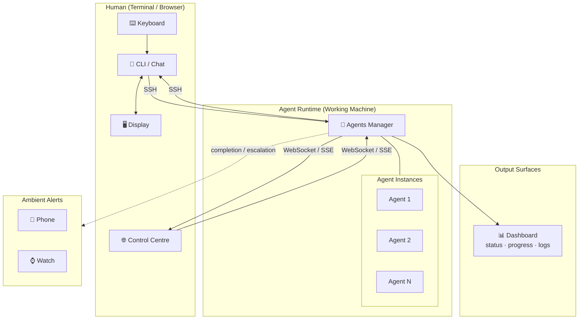

# Human ↔ AI Agent Interaction — High-Level Design

## 1. Overview

This document defines the high-level architecture for human-to-AI-agent interaction. It covers the full lifecycle of a human request — from input through processing to staged output delivery — and specifies the components, data flows, interaction patterns, and device surfaces involved.

## 2. Design Principles

| Principle                  | Description                                                                |
| -------------------------- | -------------------------------------------------------------------------- |
| **Unified Input Surface**  | One CLI / chat interface for all input — keyboard, voice, file drop        |
| **Staged Output**          | Responses delivered in stages across time and surfaces, not one-shot       |
| **Separation of Concerns** | Immediate response (chat), progress (dashboard), deliverables (artifacts), alerts (notifications) are distinct output surfaces |
| **Ambient Awareness**      | Completion and escalation push to phone/watch without requiring active attention |
| **Peer Runtime**            | Agent runtime runs on the user's own working machine, not a remote server; artifacts produced locally |
| **Multi-Agent / Multi-Task**| One agent runtime manages many agent instances; requests fan out to idle instances; dashboard aggregates across all |

## 3. Component Architecture



### 3.1 Component Descriptions

| Component              | Role                                                                                     |
| ---------------------- | ---------------------------------------------------------------------------------------- |
| **Keyboard**           | Precision text input; requires display for correction feedback                           |
| **Display**            | Bidirectional — renders interface output, captures touch input for correction / navigation |
| **CLI / Chat**         | Terminal-based text interface; connects via SSH; used on low-end devices without a browser |
| **Control Centre**     | Web-based interface served by the Agents Manager; contains dashboard view + CLI chat panel; connects via WebSocket/SSE |
| **Agents Manager**     | Runtime on the user's working machine; routes requests to agent instances, fans out staged output, manages sessions |
| **Agent Instance**     | A single process spawned by the manager; communicates via stdin/stdout (pipe mode) or PTY (interactive mode); output is streamed raw without line-buffering so ANSI escape sequences pass through |
| **Dashboard**          | Web-based view of all agent activity — progress, logs, intermediate results, blockers; embedded in the Control Centre |
| **Ambient Alerts**     | Push notifications for task completion and escalation; phone, watch, smart glasses        |

## 4. Data Flows

| Flow                        | Direction                       | Format                                              |
| --------------------------- | ------------------------------- | --------------------------------------------------- |
| Human Input (SSH)           | Keyboard → CLI → Agents Manager | Raw text via SSH stdin                              |
| Human Input (WebSocket)     | Keyboard → Control Centre → Agents Manager | Raw text via WebSocket frame             |
| Immediate Response (SSH)    | Agents Manager → CLI            | ACK, plan preview via SSH stdout (Markdown)         |
| Immediate Response (WS)     | Agents Manager → Control Centre | ACK, plan preview via WebSocket / SSE               |
| Progress Updates            | Agents Manager → Dashboard      | Step status, logs, intermediate results              |
| Completion / Escalation     | Agents Manager → Phone/Watch    | Push notification — summary, status, deep link      |

## 5. Interaction Patterns

Four core patterns — Execution, Knowledge, Creative, and Guardian — cover all Human ↔ Agent scenarios. See [human-ai-software-interactions.md](human-ai-software-interactions.md) for detailed scenario breakdowns, request/response formats, and optimum interface mappings per type.

## 6. Response Staging

Every human request follows a 4-stage response lifecycle:

| Stage | Timing          | Surface                | Content                                          |
| ----- | --------------- | ---------------------- | ------------------------------------------------ |
| **1** | < 500ms          | CLI / Chat             | ACK, parsed intent, plan preview                 |
| **2** | During execution | Dashboard              | Progress, intermediate results, logs, blockers   |
| **3** | On completion   | Deliverables           | Abstraction — summary, diff overview, architectural impact, what changed |
| **4** | On completion   | Phone / Watch          | Push notification — summary, status, deep link   |

### 6.1 Interactive TUI Extension

For long-running interactive processes (e.g., `htop`, `vim`, `nano`, REPLs), a hybrid interaction mode is supported:

- **3-second threshold**: When a process has been running for >3 seconds, the frontend displays an "Open Interactive Tab" button.
- **Interactive tab**: Opens a dedicated terminal panel that receives live raw output (including ANSI escape sequences) via SSE, while input is composed in a text box and delivered via `POST /api/process/{pid}/stdin`.
- **Latency mitigation**: Keystrokes are batched into application-meaningful blocks rather than streamed per-character, avoiding internet round-trip latency.

> For transport protocols per stage, see [Section 9 — Protocol Choices](#9-protocol-choices).

## 7. Interface Specification

The Agents Manager accepts requests through two protocols — SSH for terminal-only devices, and WebSocket/SSE for the browser-based Control Centre. Both produce the same CLI-style interaction. The interface follows a shell model — built-in commands (`ls`, `cd`, `ps`, `use`, `agents`, `history`) are handled by the Manager; all other input is forwarded to the current agent.

### 7.1 SSH — Terminal CLI

```
$ ssh agent@my-machine -p 2222

agent> Connected to Agents Manager v1.0
agent> Type a request to begin.
agent>

Human:  build a login page with email + password, add tests
Agent:  agent> Got it. Building login page.
Agent:  agent> Plan: 1) Create component  2) Wire auth  3) Add tests
Agent:  agent> Session: a1b2c3
Agent:  agent> [running] Step 1/3: Creating login component...
Agent:  agent> [done] Login page built. 3 files changed, 5/5 tests pass.
Agent:  agent>        commit abc123 | PR #42 -> github.com/.../42
```

### 7.2 WebSocket / SSE — Control Centre CLI Panel

```
Browser → http://my-machine:8080 → Control Centre loads
Shell terminal connects: ws://my-machine:8080/shell

  ← agent> Connected to Agents Manager v1.0
  → build a login page with email + password
  ← agent> Got it. Building login page.
  ← agent> Plan: 1) Create component  2) Wire auth  3) Add tests
  ← agent> Session: a1b2c3
  ← agent> [running] Step 1/3: Creating login component...
  ← agent> [done] Login page built. 3 files changed, 5/5 tests pass.
  ← agent>        commit abc123 | PR #42 -> github.com/.../42
```

### 7.3 Control Centre Layout

```
┌──────────────────────────────────────────────────────┐
│  Control Centre                    [sessions: 3]     │
├────────────────────────┬─────────────────────────────┤
│  📊 Dashboard          │  💬 CLI Chat                 │
│                        │                              │
│  ┌──────────────────┐  │  agent> Type a request...    │
│  │ a1b2c3  running  │  │  > build login page          │
│  │ Step 2/4: tests  │  │  agent> Got it. Building...  │
│  └──────────────────┘  │  agent> Plan: ...            │
│  ┌──────────────────┐  │  agent> [running] Step 1/3   │
│  │ d4e5f6  waiting  │  │  agent> [done] ...           │
│  │ queued position 1│  │                              │
│  └──────────────────┘  │                              │
└────────────────────────┴─────────────────────────────┘
```

### 7.5 Completion Notification — Stage 4

```
POST https://push-service/notify
{
  "device": "phone",
  "title": "Task complete",
  "body": "Login page built — 5/5 tests pass",
  "deep_link": "agent://session/a1b2c3",
  "priority": "normal"
}
```

## 8. Device Mapping

| Device          | Input Roles                | Output Roles                                            |
| --------------- | -------------------------- | ------------------------------------------------------- |
| **Keyboard Compute** | Typing, correction | Display: chat, dashboard, deliverables                  |
| **Smartphone**  | Touch typing, voice, camera | Display: chat, dashboard, deliverables; Notification   |
| **Smartwatch**  | Voice only                 | Glance display, haptic alerts, notification             |
| **Smart Glasses** | See-what-I-see           | AR overlay, ambient notification                        |
| **Smart Speaker** | Voice only               | Audio ACK + summary (no visual)                         |

## 9. Protocol Choices

| Channel                          | Protocol           | Use Case                             |
| -------------------------------- | ------------------ | ------------------------------------ |
| Terminal ↔ Agents Manager        | SSH                | Low-end devices, no browser; bidirectional CLI |
| Control Centre ↔ Agents Manager  | WebSocket + SSE    | Browser-based shell terminal + streaming  |
| Agents Manager → Agent Instance  | OS process (stdin/stdout pipe or PTY) | Request dispatch, result collection; raw byte streaming (no line-buffering); PTY mode for interactive TUI sessions |
| Agents Manager → Dashboard       | SSE                | Live status updates via Server-Sent Events; embedded in Control Centre |
| Agents Manager → Phone/Watch     | FCM / APNs         | Push notifications                   |

## 10. Non-Functional Requirements

| Requirement       | Target                     |
| ----------------- | -------------------------- |
| Stage 1 latency   | < 500ms (perceived instant) |
| Stage 2 frequency | ≥ 1 update/second during execution |
| Stage 3 latency   | < 2s after completion      |
| Stage 4 latency   | < 5s push delivery          |
| Session persistence | Survive disconnect, multi-device resume |
| Offline handling  | Queue input, deliver on reconnect |
| Multi-device sync | Dashboard and chat state consistent across devices |
