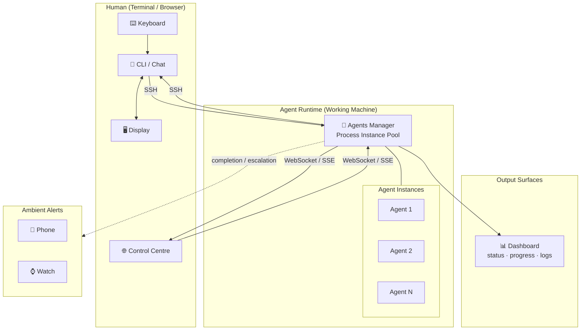
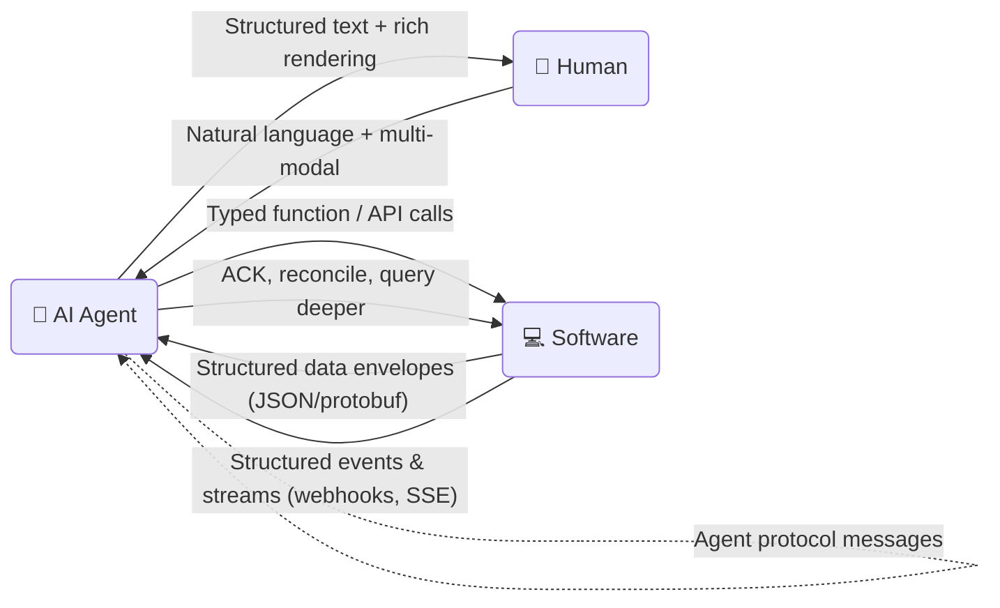

# Ideal Interaction Forms: Human, AI Agent, Software

As artificial intelligence advances and AI agents become increasingly capable, autonomous, and embedded in everyday workflows, the way humans interact with systems must evolve in parallel. Traditional human-software interfaces — designed around direct manipulation, rigid form-fills, and predictable request-response patterns — break down when an AI agent sits between intent and execution. New affordances (multi-modal input, structured prose, agent-to-agent protocols, ambient notifications, and delegated autonomy) become necessary. This document analyzes and identifies the ideal forms of interaction across all entity pairings — Human, AI Agent, and Software — mapping each request/response path to its most effective communication medium.

---

## Directional Interactions

With three entity types — **Human**, **AI Agent**, and **Software** — there are nine possible directional interaction pairs (3 × 3, including self-interactions):

- Human → Human
- Human → AI Agent
- Human → Software
- AI Agent → Human
- AI Agent → AI Agent
- AI Agent → Software
- Software → Human
- Software → AI Agent
- Software → Software

Established directions (Human ↔ Human, Human ↔ Software, Software ↔ Software) are not the focus. This document centers on the **new** interaction paths introduced by AI agents:

- Human → AI Agent
- AI Agent → Human
- AI Agent → AI Agent
- AI Agent → Software
- Software → AI Agent

---

## Human

### Common human device form factors

| Form factor            | Dominant I/O                              | Key capability                                             | Device examples                 |
| ---------------------- | ----------------------------------------- | ---------------------------------------------------------- | ------------------------------- |
| **Screen + Touch**     | Multi-touch, display, camera, speaker     | Visual + tactile, always connected, multi-modal            | Smartphone, tablet              |
| **Keyboard + Pointer** | Keyboard, mouse/trackpad, monitor(s)      | Precision input, large screen real estate, sustained focus | Laptop, desktop                 |
| **Voice + Audio**      | Microphone, speaker drivers               | Hands-free, ambient or private audio                       | Smart speaker, headset, earbuds |
| **Glance + Tap**       | Small display, touch, biometric sensors   | On-body, ambient awareness, quick actions                  | Smartwatch, fitness band        |
| **Buttons + Motion**   | Physical controls, motion sensors, haptic | Purpose-built tactile control, muscle memory               | Game controller, remote         |

### Human → AI Agent

|              | Ideal medium                                                               | What it carries                                            |
| ------------ | -------------------------------------------------------------------------- | ---------------------------------------------------------- |
| **Request**  | Natural language + multi-modal (text, voice, images, sketches, file drops) | Goals, constraints, context, acceptance criteria, priority |
| **Response** | Structured text with rich rendering (Markdown, diffs, tables, diagrams)    | Summary, plan, deliverables, confidence, action items      |
| **Forms**    | Screen + Touch, Keyboard + Pointer, Voice + Audio, Glance + Tap            | Chat, voice assistants, coding copilots, wearables         |

#### Common Interaction Scenarios

| Scenario                           | Request                                                                | Response                                                | Output                                                | Agent's role                                                              |
| ---------------------------------- | ---------------------------------------------------------------------- | ------------------------------------------------------- | ----------------------------------------------------- | ------------------------------------------------------------------------- |
| **Task Delegation**                | Natural language goal + constraints + acceptance criteria              | Plan + summary, progress updates                        | Completed deliverable, execution trace, confirmation  | Breaks goals into steps, executes autonomously                            |
| **Information Retrieval**      | Natural language query + scope + format preference                                   | Cited answer, confidence score, follow-up prompts          | Structured data, linked sources, provenance trail                         | Searches, synthesizes, and presents structured answers with provenance     |
| **Decision Support**           | Natural language dilemma + constraints + trade-off dimensions                        | Recommendation with reasoning and caveats                 | Comparison table, pros/cons, impact model, simulation results             | Models options, surfaces assumptions, recommends with confidence scores    |
| **Creative Assistance**            | Natural language brief + tone/style guidance + format target           | Ask-refine loop, guidance                               | Draft, image, diagram, or schema                      | Generates alternatives, iterates on feedback, produces polished artifacts |
| **Code Gen & Review**              | Natural language spec or code diff + context (files, docs, tests)      | Rationale, inline suggestions                           | Code block, diffs, tests, refactored files            | Generates, critiques, or transforms code with explanations                |
| **Automation & Orchestration**     | Natural language workflow + trigger conditions + error-handling policy | Execution log, success/failure summary                  | Artifact links, pipeline config, side-effect receipt  | Wires together tools and APIs, monitors progress, handles failures        |
| **Learning & Explanation**         | Natural language question + current knowledge level + preferred depth  | Layered explanation (summary → detail), interactive Q&A | Diagrams, referenced materials, worked examples       | Adapts explanations to user's level, provides progressive disclosure      |
| **Guardian & Oversight**        | Natural language policy + alert conditions + escalation rules                        | Alert with context, suggested fix                   | Enforced policy action, audit trail, auto-remediation      | Watches continuously, escalates anomalies, enforces rules proactively     |

#### Interaction Types

| Type              | Scenarios                                              | Request format                                     | Response format                                    | Presentation forms                                      |
| ----------------- | ------------------------------------------------------ | -------------------------------------------------- | -------------------------------------------------- | ------------------------------------------------------- |
| **Execution**     | Task Delegation, Automation & Orchestration            | Goals/specs + constraints + conditions          | Plan + progress + result summary                   | Chat, IDE copilot, CLI, dashboards                      |
| **Knowledge**     | Information Retrieval, Decision Support, Learning & Explanation | Queries/questions + scope + preferences         | Answers + confidence + sources + explanations      | Chat, voice assistants, search interfaces, docs         |
| **Creative**      | Creative Assistance, Code Gen & Review                 | Brief/spec + tone/style + target format           | Options + guidance + refinement loop                | Chat, IDE copilot, design tools, content editors        |
| **Guardian**      | Guardian & Oversight                                   | Policy + trigger conditions + escalation rules     | Alerts + context + suggested actions                | Notifications, dashboards, ambient displays             |

#### Solution

##### Response Staging

A single human request produces multiple responses across time and surfaces:

| Stage | Timing          | Surface                | Content                                          |
| ----- | --------------- | ---------------------- | ------------------------------------------------ |
| **1** | Immediately     | Chat (where input was) | ACK, parsed intent, plan preview                 | WebSocket / SSE  |
| **2** | During          | Dashboard              | Progress, intermediate results, logs, blockers   |
| **3** | On completion   | Primary device         | Abstraction — summary, diff overview, architectural impact |
| **4** | On completion   | Phone / Watch          | Push notification — summary, status, action link  |

##### Optimum Interface by Interaction Type

| Interaction Type | Input          | Immediate response      | Dashboard        | Final deliverable on      | Notification to     |
| ---------------- | -------------- | ----------------------- | ---------------- | ------------------------- | ------------------- |
| **Execution**    | Voice / Text   | Plan + task started     | Step progress, logs | Laptop / Desktop          | Phone, Watch        |
| **Knowledge**    | Voice / Text   | Cited answer            | —                | Any display               | —                   |
| **Creative**     | Voice / Text   | Options preview         | Iteration history | Laptop / Desktop          | Phone               |
| **Guardian**     | Passive (auto) | —                       | Live alerts, status | Dashboard                 | Phone, Watch, Glasses |

---

## AI Agent

### AI Agent → Human

|              | Ideal medium                                                           | What it carries                                                      |
| ------------ | ---------------------------------------------------------------------- | -------------------------------------------------------------------- |
| **Request**  | Structured prose — targeted questions, approval gates, blocker reports | Clarification asks, destructive-action checkpoints, progress updates |
| **Response** | Natural language — brief replies, decisions, corrections               | Decisions, corrections, new context, delegation of autonomy          |
| **Forms**    | Screen + Touch, Keyboard + Pointer, Voice + Audio, Glance + Tap        | Notifications, chat replies, ambient audio, wrist taps               |

---

### AI Agent ↔ AI Agent

|              | Ideal medium                                                                                                      | What it carries                                                       |
| ------------ | ----------------------------------------------------------------------------------------------------------------- | --------------------------------------------------------------------- |
| **Request**  | Agent protocol messages — typed task descriptions, delegation payloads, capability advertisements (e.g. A2A, MCP) | Sub-tasks, specialized queries, context handoff, capability discovery |
| **Response** | Structured result envelopes — typed outputs with confidence scores, provenance, and error traces                  | Completed sub-tasks, retrieved knowledge, escalated failures          |

---

### AI Agent → Software

|              | Ideal medium                                                                            | What it carries                                                     |
| ------------ | --------------------------------------------------------------------------------------- | ------------------------------------------------------------------- |
| **Request**  | Typed function / tool calls — schema-validated, idempotent (REST, GraphQL, gRPC, shell) | Action + typed params, auth, pagination, timeouts, idempotency keys |
| **Response** | Structured data envelope — typed payload (JSON/protobuf) with status code and metadata  | Result, success/failure, error object, timing, side-effect receipt  |

---

## Software

### Software → AI Agent

|              | Ideal medium                                                                                | What it carries                                                       |
| ------------ | ------------------------------------------------------------------------------------------- | --------------------------------------------------------------------- |
| **Request**  | Structured events & streams — webhooks, SSE, pub/sub, file watchers, deferred job callbacks | State changes, streaming chunks, heartbeats, async completion results |
| **Response** | Structured consumption — parse event, ACK, reconcile state, request deeper data             | ACK/NACK, follow-up query, internal state update, human escalation    |

---

## Summary

| Pair                | Ideal media register                                              |
| ------------------- | ----------------------------------------------------------------- |
| Human ↔ AI Agent    | Natural language + multi-modal ↔ structured text + rich rendering |
| AI Agent ↔ AI Agent | Agent protocol messages ↔ structured result envelopes             |
| AI Agent ↔ Software | Typed function/API calls ↔ structured data envelopes              |
